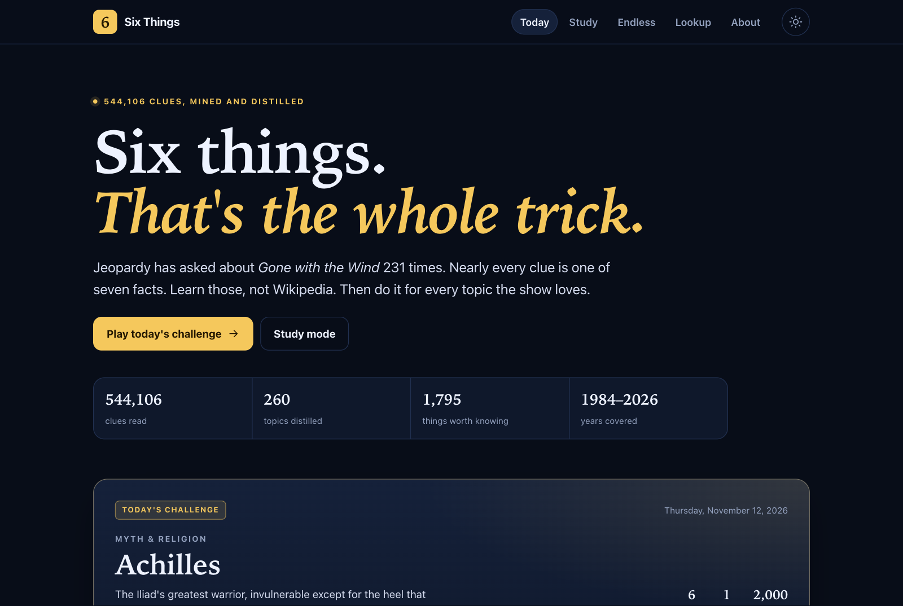

# Six Things

**The trivia you actually need.** Daily challenges and endless study built from every clue in *Jeopardy!* history.

**Play: [zarguell.github.io/trivia](https://zarguell.github.io/trivia/)**



---

## Why I built this

I got the idea from [C W's video on studying for *Jeopardy!*](https://youtu.be/wZq-eRimBE8). The insight is not "learn more trivia." It is that *Jeopardy!* asks the same handful of things about a topic, over and over, and almost nothing else.

The example in the video is *Gone with the Wind*. Wikipedia will give you 13,000 words. The archive gives you 231 clues — and they collapse into about seven facts: Margaret Mitchell wrote it, it won the Pulitzer, the 1939 film, Scarlett, Rhett, Tara, Hattie McDaniel. Learn those and you can answer nearly every clue the show has ever written about the book.

Then I was at bar trivia. The question: *which nut, besides the almond, appears in the Bible?* Pistachio. I looked it up in the archive and found the same fact asked again and again — 1990, 1991, 1992, 1996, 1997, 2001, 2004, 2014. Trivia is not an encyclopedia. It is a small set of associations, recycled.

So the thesis: **if you dissect the archive into the handful of things each topic actually tests, you get very good at trivia.** This site does the dissection.

## The game

**Daily challenge.** Seven questions on one topic: six clues plus a final. The puzzle is deterministic by date, so everyone gets the same one. Answers are typed — spelling is forgiven, surnames count. Your score and a shareable grid are stored on your device.

**Study mode.** Every topic is a six-minute lesson: four to seven facts, the association chips that jog them, and the real clues that prove each one. Mark what you knew; mastery is tracked locally. Then take the quiz, which is drawn from real archive clues, not generated questions.

**Endless mode.** Four-choice rapid fire across a curated pool of real clues, balanced by deck and difficulty. A wrong answer resets the streak, never the session.

**Lookup.** Type an answer — `pistachio`, `Buchanan`, `Gone with the Wind` — and see the actual clues, with air dates. The archive is sharded by answer so a lookup fetches one small file, not the whole corpus.

## By the numbers

| | |
|---|---|
| Clues mined | **544,106** (1984–2026) |
| Distinct answers | **114,819** |
| Curated topics | **260** |
| Essential facts | **1,794** |
| Real clues in packs | **4,177** |
| Clues searchable in Lookup | 538,616 |

## How it works

```
raw J! Archive-derived TSV
        │
        ▼
pipeline/build_corpus.py     normalize, filter media/wordplay, deck taxonomy
        │
        ▼
pipeline/mine.py             topic candidates + evidence dossiers
        │
        ▼
data/work/shortlists/*.json  self-contained authoring briefs
        │
        ▼
data/topics/*.json           curated facts, each citing real clue ids
        │
        ▼
pipeline/site_data.py        daily puzzles, endless pools, lookup shards
        │
        ▼
site/build.mjs               custom static site generator → dist/
        │
        ▼
GitHub Actions → GitHub Pages
```

### Mining the archive

Every clue is normalized into `{clue, response, category, round, date, deck}`. Candidates come from the answers themselves — the topics the show keeps asking about — plus a curated seed list. For each topic, the miner collects every clue where it is the answer or is mentioned, then measures:

- **what it is the answer to** and which words keep appearing in those clues
- **which answers cluster around it** when it is only mentioned
- **how often** it comes up, first and last air date, category distribution

Those evidence dossiers become the authoring briefs. Curators write the handful of associations — grounded in the brief, never invented — and attach one to three real clue ids to each fact. `pipeline/validate_packs.py` rejects broken packs, missing clue ids and duplicate labels.

### The static site generator

`site/build.mjs` is a from-scratch SSG with zero runtime dependencies: it reads structured JSON, renders every page with template literals, copies the client assets, and writes a static `dist/`. The client is vanilla ES modules; no React, no bundler.

Pages generated: home, daily challenge, daily archive, study index, one page per deck, one page per topic, endless, lookup, about, 404, sitemap and manifest. Topic pages are server-rendered for speed and include their own quiz payload.

The data shipped to the browser is deliberately compact:

- daily puzzles split by year (~650 KB each)
- one clue pool per deck for endless (~580 KB each, loaded on demand)
- lookup shards by the first two letters of the answer (tens of KB to ~1 MB each)

## Run it locally

Requires Node 22+ and Python 3.11+. No npm install.

```bash
make data     # expand the committed corpus + generate puzzles/pools
make build    # render dist/
make serve    # http://127.0.0.1:4173/trivia/
```

Tests and checks:

```bash
make test       # quiz answer matching, distractors, normalization
make validate   # curated packs against the corpus
make check      # every built link + JSON payload
```

To rebuild the corpus from the raw release:

```bash
# download the TSV release into data/raw/, then
python3 pipeline/build_corpus.py
gzip -9 -c data/work/clues.jsonl > data/corpus/clues.jsonl.gz
```

Then re-mine and re-curate as needed:

```bash
python3 pipeline/mine.py
python3 pipeline/shortlist.py
```

## Repo layout

```
data/corpus/clues.jsonl.gz   normalized 544k-clue corpus (committed for CI)
data/topics/                 curated topic packs (the knowledge)
data/work/                   dossiers + briefs (generated; gitignored)
data/generated/              site data (generated; gitignored)
pipeline/                    corpus build, mining, briefs, validation, site data
site/build.mjs               the static site generator
site/lib/html.mjs            HTML toolkit
site/client/                 vanilla CSS/JS + shared quiz core
scripts/                     local server, post-build integrity check
tests/                       node:test unit tests
.github/workflows/deploy.yml build + deploy to Pages
```

## Deploy

Push to `main`. The workflow restores the corpus, validates packs, generates data, runs tests, builds `dist/`, checks every link, and deploys to GitHub Pages. `BASE_PATH=/trivia/` matches the project page. `renovate.json` keeps GitHub Actions and metadata current, with safe updates set to automerge. Install the Renovate app on this repository once to activate it.

Enable Pages once:

```bash
gh api -X POST repos/zarguell/trivia/pages -f build_type=workflow
```

## Credit and legal

- The corpus is a cleaned, text-only [Jeopardy! clue dataset](https://github.com/jwolle1/jeopardy_clue_dataset) covering seasons 1–42, derived from the fan-run [J! Archive](https://j-archive.com/).
- The idea comes from C W's [“How to Study for Jeopardy”](https://youtu.be/wZq-eRimBE8).
- All clues and responses are the property of Jeopardy Productions, Inc. This is an unaffiliated, non-commercial fan project for personal study. No images or media-dependent clues are included.
- Code is MIT licensed. The curated facts are original writing; the underlying clues are not.

If you own the rights to something here and want it changed, open an issue.
